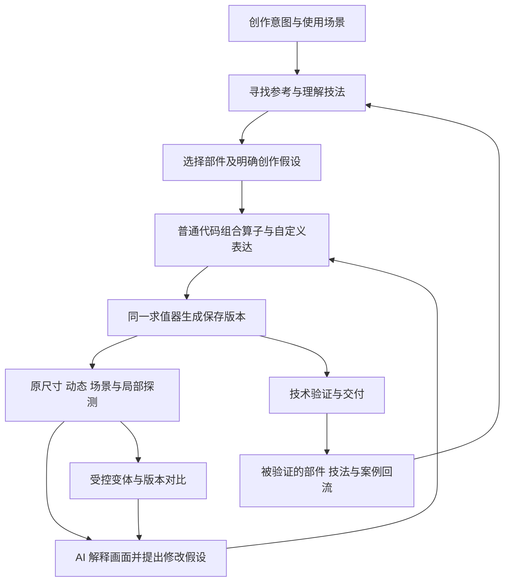

# AI 像素特效创作工具产品全景设计

本产品面向能编写代码、调用工具并观察图像的 AI 创作者，也服务于给 AI 提需求和作最终取舍的游戏设计师与美术负责人。目标是让 AI 从参考中理解表现方法，局部复用成熟机制，创造新的结构与运动，并通过观察和修改持续提高表达质量。

产品由**参考与技法库、可组合的创作能力、观察与实验工具**共同组成。作品保持普通代码的开放性；成熟计算交给算子；工具让结构、参数、结果和问题可查询、可定位、可复验。是否传达了速度、重量、温度、情绪与用途，由创作者结合画面判断。

状态：产品方案。现有七个实验工具的能力以 [MVP 文档](../../experiments/vfx-lab/README.md)为准。实现依据见[库实现与能力地图](implementation-map.md)，具体接口见[工具定义与数据契约](tool-contracts.md)。本方案中的新算子和扩展接口尚未实现。

## 1 产品要解决的问题

| 创作目标 | 产品提供的能力 | 成功时 AI 能做到什么 |
| --- | --- | --- |
| 能参考 | 同尺度图像、运动证据、表现机制、代码出处、适用条件和反例 | 理解一个效果为什么成立，决定借什么、改什么 |
| 能局部复用 | 部件、算子、路径、场、mask、材质、时间关系及其依赖 | 只借刀光头尾分离、水流纹理或落地涟漪，不被迫复制整个作品 |
| 能创作 | 可组合原语、可替换部件、普通代码与自定义绘制入口 | 发明已有预设之外的形状、运动、材质与编排 |
| 能减负 | 采样、求解、像素处理、缓存、重放、诊断、交付 | 少写重复循环，少猜单位和状态，少为看图修改作品 |
| 能提升表达 | 技法讲解、针对问题的观察视图、有控制的对照实验 | 把“感觉不对”转成可验证的艺术假设，再据画面修改 |

关键任务包括战斗命中与招式、环境循环、身体状态与变形、生成消失、界面反馈和屏幕转场。粒子是其中一种构成方式；程序轮廓、连续体、遮罩变化、像素着色、文字与角色表演同样是一等创作能力。

首个运行环境沿用本地 JavaScript、CLI 和 MCP，不绑定某个模型或图形界面。AI 使用已有文件工具编辑作品，使用本产品的接口寻找能力、运行作品和取得证据。人类可以看预览并指导方向，但产品不要求人类代替 AI 操作参数面板。

## 2 从现有实现得到的产品判断

对当前库的统计为 244 个效果、21 个分类。其中 112 个通过直接绘制入口实现，132 个通过创建入口实现，后者包含复合效果；108 个循环全部使用直接绘制入口。73 个效果声明角色与动作，37 个动作使用身体映射。统计口径和源码版本保存在 [inventory.json](inventory.json)。

库中已经形成几组重要方法：

- **形状与着色共同构成主体。** 刀光用局部坐标中的弧带与头尾区间，瀑布用条带、周期纹理和断裂，黑洞用逐像素空间映射与色阶。不能只提供粒子贴图来表达这些主体。
- **因果关系比独立定时器更有价值。** 冰波到达后晶体生长，水滴落地后涟漪出现，燃烧边缘经过后释放烟灰。应共享到达、接触和变化区域，减少手工同步。
- **部件已存在但难以发现。** 20 个分类辅助模块中有火舌、水滴、涟漪、裂纹、刀光、残影、文字扫光等实现；另有大量机制仍与单件作品耦合。
- **像素规则已经进入运行时。** 本地坐标、硬像素、Bayer 透明、软透明、调色板和颜色光层分离都有实现。应沿用并明确契约，而不是重新包成通用图片滤镜集合。
- **角色表演参与特效表达。** 蓄力、出手、接触停顿、受击与恢复需要与特效事件对齐。

Spine Particle 的参考价值在于发射、出生属性、生命周期、运动修改、路径、资源和光带的分解。其面板选项仍有条件耦合，噪声与图像处理覆盖也有限。采用其能力组织经验，结合本库的程序形状、像素和角色机制；具体依据沿用已固定观察版本的[工作台调研](../../experiments/vfx-lab/research/tsnm-spine-particle/README.md)。

由此确定四项产品选择：以普通代码和可调用算子为创作基础；让中间结果可以复用；将公共时钟、坐标和事件作为底座；用证据支持艺术判断，保持审美取舍开放。

## 3 产品整体结构



产品包含以下相互衔接的部分：

| 部分 | 主要内容 | 对其他部分的约束 |
| --- | --- | --- |
| 参考与知识 | 成品案例、技法说明、部件目录、反例与来源 | 每个能力声明有出处和成熟度；看过画面才能作视觉判断 |
| 创作内核 | 形状、场、图像、发射、运动、材质、光、动作和编排 | 共享单位与时钟；输出可继续组合；保留自定义代码 |
| AI 工具接口 | 搜索、检查、建稿、复用、渲染、探测、对照、验证、历史与导出 | 定义可发现、返回精简、错误可恢复、所有证据有版本身份 |
| 观察与实验 | 原尺寸、动态、图层、轨迹、遮罩、明暗、场景和变体 | 图像支持真实时间和尺度；量测不能冒充审美结论 |
| 资产与记录 | 源码、参数、资产、依赖、参考关系、运行和取舍说明 | 保存版本不被后续编辑覆盖；交付可追溯 |

## 4 创作对象与最小公共约定

### 4.1 创作意图按需逐步补充

AI 可以从一句话开始。第一次可见草稿前，至少明确用途、作品尺度、主要动作和一个待验证的问题。无需先填写完整需求表。

随着创作补充 `brief`：主体轮廓、材质、节奏、配色、角色与场景关系、应保留的特征、不希望发生的视觉结果。未指定项可由 AI 选择并记录为假设，后续可修改。

可选的 `styleProfile` 描述项目风格与资源约束，例如有限色、低辉光、粗像素簇、柔烟、界面文字可读性。当前库偏好的亮边、光感和多阶段节奏作为一个风格参考，不升级成所有像素作品的强制美学。

### 4.2 作品保留两种求值方式

解析型作品由时间直接求值，适合循环、路径、场和无历史依赖的运动。模拟型作品用固定步长更新，适合碰撞、事件链与历史轨迹。两者共享绘制、事件、资产和观察接口，允许同一作品混用。

可选的结构描述声明稳定的层和可观察对象，例如 `main_smear`、`sparks`、`residue`，以及公开参数、引用、事件和可探测属性。该描述用于发现与诊断，不要求把全部作品逻辑转换成节点图。任意旧模块可以作为整体接入；未声明内部层时，只承诺整体观察能力。

沿用 `meta` 与 `draw/create` 作为作品来源，可新增可选 `authoring` 导出声明这些契约。基础算子自动提供约定的观测点；自定义代码显式报告需要被观察的结果。仅在元数据里写了一个层名称，并不能凭空获得内部轨迹。工具生成的图或清单是源码的投影，不建立另一份需要作者同步维护的逻辑。

### 4.3 公共语义

| 项目 | 约定 |
| --- | --- |
| 尺度 | 创作单位为艺术像素，支持浮点计算，栅格化策略显式；原点可查询 |
| 坐标 | 区分作品、发射器、资产、身体和场景空间；变换由公共设施处理 |
| 时间 | 区分场景时间、局部时间、粒子年龄与归一化年龄；路径距离另用 `s` 表示 |
| 表演 | 特效时间与播放时间分开；命中停顿明确冻结哪些对象，支持负时间蓄力 |
| 颜色 | 公共新接口接受明确颜色输入并在边界转换；旧 Painter 的 Color32 契约可查询 |
| 透明 | 区分硬覆盖、抖动覆盖与软 alpha，注明抖动锁定的坐标域 |
| 光 | 颜色与附加光分开保存；亮核、外光、半径和强度可分别控制 |
| 随机 | 使用稳定粒子身份与具名随机通道；需要属性相关性时显式共享变量 |
| 结束 | 声明清空、稳定残留、持续存在、转交下一效果或循环；检查遵循作品约定 |
| 周期 | 场、发射和生命周期共同说明周期；既检查接缝图像，也观察附近运动 |

默认值必须能查询。工具不通过静默缩短寿命、改变出生域、夹住艺术超调或重新排种子来“修复”作品；无效数据与艺术选择分开处理。

## 5 参考系统如何帮助 AI 学会表现

### 5.1 内部作品与外部参考共同使用

参考可以是库中作品、自己的历史运行，也可以是用户提供的静图、动画、精灵表、视频或游戏场景截图。通过检查入口读取本地参考文件，固定原文件摘要，按实际解码能力提取帧、持续时间、色带和区域；记录已知原尺寸以及未知信息。

AI 结合图像提出轮廓、节奏与材质的观察，工具保存标注与对应证据。只有图像的参考属于观察资料，不伪造原始粒子系统、运动代码或作者意图。可复用的是明确选择的图像资产，或由 AI 重新设计、再验证的机制。

### 5.2 检索从主题扩展到机制与问题

搜索既支持“冰霜”“爆炸”，也支持“沿边缘推进”“落地后出现波纹”“明亮头部和延迟尾迹”“像珠链而不是连续斩击”等表达。结果按对象区分成品、可调用部件、算子、技法、资产与运行记录。

每条结果解释匹配的机制，注明是已登记部件还是仅供阅读的代码，并提供同尺度预览或可运行的预览入口。搜索不必一次返回整份源码；AI 可以继续请求签名、示例、依赖或相关代码。

### 5.3 技法条目必须连接表现目的与实现

一个技法条目包含：

| 内容 | 例子 |
| --- | --- |
| 表现目的 | 一击迅速掠过，结束后还能读出运动路径 |
| 感知机制 | 前缘快到达，尾缘延迟追上，尖端给出短促焦点 |
| 可组合结构 | 路径、头尾区间、宽度包络、色阶、接触火星 |
| 关键创作选择 | 弧度、最厚位置、头尾速度差、峰值持续时间 |
| 适用与限制 | 短程挥砍；极小尺度需要简化，不能依赖细碎火星支撑主体 |
| 视觉证据 | 原尺寸连续帧、无光视图、改变一个因素的对照 |
| 实现入口 | 部件与算子引用、源码位置、版本和来源署名 |

同一表现目的提供多种实现方向。重量可以来自大幅蓄势、短停顿、形变、迟滞或环境反馈，不必统一加震屏；能量也可以表现为暗色侵蚀、负空间或规则断裂。

### 5.4 观察指导是一组可调用的实验

将“方向不清”“像烟而不像水”“打击不够重”等问题映射到观察方法、可能机制和小实验。指导以条件和证据为基础，不自动改参数。

例如：

| 问题 | 先取什么证据 | 可比较的修改方向 |
| --- | --- | --- |
| 刀光像珠链 | 原尺寸连续帧、主体单层、轨迹覆盖 | 连续弧带与离散粒子主体；更短与更长的尾迹 |
| 能量像漂浮灰尘 | 速度轨迹、事件前后、去光视图 | 汇聚加速与匀速；少量大块与均匀细点 |
| 烟雾像棋盘 | alpha 与色层、深浅背景 | 软透明体积与硬像素覆盖；保留轮廓的混合方案 |
| 环境循环抽动 | 周期边界连续帧、粒子身份和速度 | 周期场与重置状态；整数周期与任意频率 |
| 特效脱离角色 | 动作、挂点、前后遮挡和命中事件 | 改出手时机、跟随策略或主体路径 |

AI 的判断过程是“观察事实—提出可能原因—选一个实验—再观察”。例如工具可以指出白色覆盖率在峰值骤增；“它淹没了主体，所以应减少外光”仍需结合创作意图和图像论证。没有看图能力的调用端可以取得证据和技术数据，但不能仅凭数值自动认证艺术质量。

## 6 局部复用产品设计

### 6.1 复用对象分层

| 层级 | 复用对象 | 需要保留的契约 |
| --- | --- | --- |
| 整体效果 | 现成模块或一段完整子效果 | 参数、坐标、时间、结束方式与依赖 |
| 视觉部件 | 刀光、烟团、涟漪、裂纹、晶体、残影、文字扫光 | 几何与材质输入、随机性、输出层和可替换部分 |
| 运动与时间机制 | 弹道、传播到达、头尾追赶、生命周期包络 | 时间域、单位、边界、事件语义与求解方式 |
| 中间资产 | 路径、场、mask、像素材质、序列与色带 | 分辨率、空间、轴点、周期、采样与数据含义 |
| 创作配方 | 带创作选择点的组合方法 | 展开后的部件与参数，适用条件和视觉证据 |

配方可以提供起点，但不封闭成“冰魔法”“火魔法”有限枚举。作者可以换主体、运动或材质；自定义代码与现成算子具有相同的版本和验证入口。

### 6.2 三种落地路径

**调用已经模块化的能力。** 从分类辅助模块开始登记与包装，固定依赖和签名，生成可修改的导入与适配代码。先保证某个具体部件好用，再决定是否抽象成通用算子。

**烘焙中间资产。** 对无需在运行时继续变化的形状、纹理或动画，按明确参数和尺度保存为 mask、图像或序列；记录哪些运行时可变性因此丢失。烘焙成品图片不会自动保留其粒子、路径或光的可编辑结构。

**提取耦合片段。** AI 结合源码选择边界、改写新部件；工具检查依赖、记录来源、构造隔离预览并比较迁移前后。普通动态 JavaScript 不能保证任意片段自动提取。未模块化片段被标记为候选，不向调用方伪装成已经稳定的部件。

复用记录包括原始参考、版本、保留机制、改写部分和已有署名。除显式选择更新外，旧作品固定使用旧部件版本。一次成功复用不自动把草稿发布为公共部件。

### 6.3 防止复用把作品锁死

部件暴露能够改变艺术结构的接口，不只暴露颜色和数量。例如刀光应能替换路径、头尾包络、厚度分布与边缘材质；消融应能替换排序场、推进方式与边缘响应。复杂风格实现可以保留为部件，基础几何与字段语义尽量独立。

可复用层提供几何、场或事件输出，使别的部分能够响应。无法返回中间结果的成品仍可作为整体子效果使用，但不承诺内部局部编辑。

## 7 创作能力全景

基础能力按“对象从哪里来、怎样变化、怎样成像、怎样协同”组织。下面是产品覆盖面，签名与状态映射详见[能力地图](implementation-map.md)。

| 能力域 | 目标能力 |
| --- | --- |
| 几何与主体 | 点线面、弧带、轮廓、距离场、形变、破碎与生长；支持直接像素着色 |
| 发射与出生 | 几何或 mask 密度采样、时间或距离发射、爆发、常驻、分布和属性相关性 |
| 生命周期 | 任意属性的曲线、色带、分阶段包络、绑定和结束方式 |
| 运动与环境 | 解析弹道、力与场、阻力、路径、跟随、朝向、碰撞、容器、接触响应 |
| 路径与拖尾 | 弧长、切法线、头尾区间、历史轨迹、程序条带、速度拉伸和死亡消散 |
| 场与噪声 | 标量与向量场、周期与平铺、分形、梯度、旋转、扭曲、组合和到达时间 |
| 贴图与材质 | 程序贴图、像素簇、单图与序列、色带、轴点、采样和材质坐标 |
| 图像与 mask | 流动、位移、消融、阈值、膨胀腐蚀、描边、布尔组合、抖动和重采样 |
| 颜色与光 | 色阶、明暗、色相偏移、核心与外光、区域光、颜色光分离与可选受限调色板 |
| 身体与表演 | 轮廓、身体像素、挂点、前后遮挡、姿态、命中停顿、受击和恢复 |
| 编排与反馈 | 共享事件、传播到达、落地、出生死亡、mask 变化和多效果组合 |
| 界面与符号 | 像素文字、符号、图标、扫光、挤压回弹、计数与状态反馈 |

每个算子都应减少一种明确的重复劳动，并有输入输出定义、一个可运行示例、相关观察方法和适用限制。未达到这一要求的实现先作为参考，不扩充公共能力目录。

## 8 AI 工具界面

工具界面包括可查询的 SDK 函数定义、资料资源和 CLI/MCP 方法。细粒度计算由真实实现的 SDK 算子批量执行；工作流方法处理作品、资产和证据，不逐粒子或逐像素调用。

目标接口共 11 个，保留现有七个名称并增加四个入口：

| 工具 | 产品职责 | 与现有实现的关系 |
| --- | --- | --- |
| `fx_search` | 找案例、技法、算子、部件、资产和问题对应的方法 | 扩展搜索对象与解释 |
| `fx_inspect` | 查询契约、示例、来源、依赖、能力和源码 | 补齐精确的创作 API 与成熟度信息 |
| `fx_scaffold` | 创建可编辑作品和最小创作记录，可显式装配已选部件 | 提供空白、解析、模拟和组合起点 |
| `fx_reuse` | 将部件或烘焙资产带入草稿，准备提取候选的依赖与对照 | 新增；不自动替创作者选择表现方法 |
| `fx_render` | 生成不可变运行，取得原尺寸、动态及场景证据 | 统一求值器，支持完整动作和重放 |
| `fx_probe` | 查询局部状态、轨迹、中间结果和观察视图 | 新增；按实际可观测能力提供结果 |
| `fx_compare` | 对齐版本、场景与观察条件 | 扩展时间窗口、采样与尺度说明 |
| `fx_explore` | 批量运行作者指定的变体与实验轴 | 新增；不自动评选最美版本 |
| `fx_validate` | 检查技术契约、约束、复现与运行预算 | 增加保存版本目标与结束策略 |
| `fx_history` | 找回作品、分支、运行、差异和取舍记录 | 新增公开入口，支持恢复上下文 |
| `fx_export` | 从明确的保存版本交付代码、资产或图集 | 保持目标身份，区分附加光与普通 alpha |

工具按需返回定义和细节，避免首次把全部算子 schema 塞入上下文。艺术知识通过搜索和检查取得，艺术评议由创作者执行；不另设一个没有证据来源的“艺术评分工具”。

## 9 创作流程与减负策略

### 9.1 最短可用链路

```text
一句意图 → 找参考或能力 → 创建作品 → 普通代码编辑 → 看渲染
                                      ↑              ↓
                                 修改假设 ← 观察与探测
                                              ↓
                                         验证与导出
```

如果 AI 已知道所需 API，可以直接建稿与运行。无需强制经过所有工具、编写完整策划或固定迭代次数。复杂问题再逐步引入复用、定点探测与受控变体。

### 9.2 每轮只承担必要的工作

常规结果优先包含版本身份、关键图像、相对上一版的变化、最多几个主要诊断以及相关入口。完整帧表、依赖清单和运行环境保存到清单，按需展开。

工具自动承担渲染脚本、事件附近抽帧、同条件对比、图层单独查看、轨迹叠加、中间 mask 与场查看。作者不必为了观察反复改作品、插入调试绘制或重写图片拼接。

同一运行的已有证据优先复用。只读观察不创建艺术新版本；需要额外求值时，从冻结源码生成有父记录的分析产物，标明实际采样。改背景、挂点或光强产生新的实验条件，不冒充同一次运行。

局部修改保留层 ID、粒子 ID 和随机通道。缓存仅复用依赖和参数未变化的结果；自定义代码依赖不明时保守重算，不承诺任意代码都能增量执行。

## 10 两个完整创作场景

### 10.1 非对称熔渣内收与冲拳

意图：38 像素高角色蓄力，熔渣由两条不对称路径汇入拳心，短暂停顿后向右推出厚头薄尾的脉冲，落地留下弱亮余烬。主体不能读成均匀放射爆炸。

| 步骤 | AI 的创作决定 | 工具提供的能力与证据 |
| --- | --- | --- |
| 参考 | 借用刀光的头尾追赶，借用爆炸的落地残留，改变材质与主体 | 机制检索、同尺度参考、具体部件契约 |
| 草稿 | 选择两条汇入路径、压缩时长与释放轮廓 | 路径、出生采样、曲线、随机属性、条带与光 |
| 首次观察 | 判断方向、重量、角色关系 | 原尺寸播放、释放连续帧、去光主体和动作视图 |
| 局部修改 | 如画面像珠链，把主脉冲改成连续条带，保留少量碎渣 | 保留其他层身份，只替换主体部件；轨迹与层差异 |
| 再验证 | 比较停顿与释放关系、余烬是否过早消失 | 自选事件窗口、落地事件、颜色与光分层 |
| 交付 | 选择最符合用途的一版 | 保存版本的技术检查与导出 |

减负来自采样、路径、头尾栅格化、落地与残留管理、观察和复验；两条路径如何不对称、熔渣为何厚重、停顿是否合适，仍是创作。

### 10.2 角色表面结霜后沿裂纹消失

意图：霜纹从手臂向胸口蔓延，受冻结后的轻微颤动影响，接着沿既有裂纹分块消失；表面颜色仍能看出原角色，少量冰屑从变化边缘脱落。

| 步骤 | AI 的创作决定 | 工具提供的能力与证据 |
| --- | --- | --- |
| 参考 | 借身体轮廓分析、裂纹生长和消融排序，各自只取局部机制 | 身体空间、mask、路径与到达场的契约 |
| 构造 | 定义生长源、传播路径、表面着色与裂纹尺度 | 轮廓采样、距离或到达场、受限着色、mask 运算 |
| 联动 | 让裂纹推进产生可见边缘和被移除区域，驱动冰屑与光 | 同一中间结果连接图像、发射和发光 |
| 观察 | 判断霜纹是否读成随机噪点、身体跟随是否正确 | 原尺寸、角色移动场景、单独 mask 与到达时间图 |
| 局部修改 | 只改传播次序与裂纹密度，保持角色颜色和碎屑运动 | 稳定字段、资产引用和随机通道；对比范围可控 |
| 验证 | 确认跳帧不重复发射、身体空间正确、结束方式符合约定 | 重放、事件身份、空白或转交策略检查 |

这个场景要求非粒子主体、图像算法、角色映射和因果联动共同工作，可防止产品能力只覆盖“发射更多粒子”。

## 11 工具与创作者的职责

| 工具负责的能力 | 创作者负责的选择 |
| --- | --- |
| 正确采样、插值、积分、变换、栅格化和像素扫描 | 轮廓、空间构图、动势、明暗组织与材质语言 |
| 公共时钟、随机通道、生命周期和接触事件 | 节奏、夸张方式、取舍、对称或不对称 |
| 中间结果、缓存、历史、重放与交付 | 哪些层存在，哪些因素服务主体，何时删去细节 |
| 技法和反例、可执行的实验与可解释的诊断 | 怎样解释证据，优先解决哪个问题，选哪一版 |
| 可展开的常用组合、开放的代码扩展入口 | 发明新的形状、运动与组合规则 |

边界按重复性与表达意义划分。例如求弧长应由工具负责，弧线怎样弯由作者决定；消融的差分区域由工具负责，哪里先消失由作者设计；工具提供多种透明策略，作者选择其材质效果。写少量独特造型代码不是产品失败，为每件作品重复实现公共采样或重放则是明确的改进信号。

## 12 技术架构与兼容

作者接口和执行内核分开。SDK 算子、部件和旧模块适配器进入同一个运行接口；CLI、MCP 与未来人类预览端共用工具定义和执行服务。人类界面不拥有另一套创作状态。

数据主要包括作品源码、可选结构描述、部件与资产、意图记录、保存版本和分析产物。区分三种身份：

1. **作品修订**固定源码、参数及依赖资产。
2. **运行版本**固定作品修订、场景、时钟、采样和输出设置。
3. **分析与交付产物**引用明确运行，记录自己的观察或导出设置。

工作区中，作者主要编辑效果模块、必要的局部部件和简短创作记录；依赖摘要、冻结快照、帧表和分析清单由工具生成。能力定义同时生成可查询文档和索引，减少代码、工具 schema 与说明之间的不一致。SDK 观测接口和运行适配层独立于 MCP，供所有调用端共用。

渲染、跳转、探测、验证与输出共用求值器；输出帧率只决定采样。解析运动直接求值，历史模拟默认固定 tick，报告实际求值时刻。已有主库“每步不大于 1/120 秒”和实验固定 tick 的差异需要显式适配，不能悄悄替换所有旧作品的行为。

旧作品先整体接入，再逐步登记内部部件和观测点。只有声明了可观察状态、输出层或中间结果的模块，才开放相应局部操作。无状态序列化的旧模拟通过从头重放实现；检查点优化是后续能力。

重放包固定本地依赖、资产、环境与后端版本；动态依赖无法冻结时报告具体缺口。运行预算按帧像素、模拟步数、粒子数和耗时检查，长任务可取消且保留已完成证据。性能结论附运行条件，当前库风格文档中的固定耗时目标不直接当成跨设备产品保证。

## 13 分期交付

| 阶段 | 交付重点 | 进入下一阶段的条件 |
| --- | --- | --- |
| A 契约与证据底座 | 精确 API 查询、颜色和时钟约定、保存版本验证、自选比较窗口、精简返回、历史检索 | 新创作者能从公开定义入门，旧版本可复查，现有作品继续运行 |
| B 创作核心闭环 | 路径与采样、排期、曲线、稳定随机、基础运动、条带与光；同时交付场、mask、消融和变化区域 | 上述两个完整场景均能创作、局部修改与复验，不让作者重复实现承诺的基础能力 |
| C 局部复用与艺术实验 | 首批成熟部件、来源与依赖、烘焙资产、候选提取流程、定点探测和受控变体 | 复用能改变结构与材质，隔离观察可用，独立创作者测评有比较证据 |
| D 能力扩展与生产交付 | 更完整向量场与图像流动、破碎和材质包、复杂挂点、目标引擎适配与缓存优化 | 各能力有真实作品需求和回归证据，目标引擎导入分别验证 |

阶段 B 包含图像与场链，避免再次只完成外层工作流。先选少量代表性部件打通语义和联动，再扩充数量；不在首次交付重写 244 个作品，也不优先建设节点编辑器、协作平台或 Spine 导出适配。

首批建议登记：头尾刀光、传播到达与生长、水滴接触涟漪、火烟冷却与残留、身体轮廓与表面着色、mask 边缘衍生粒子、周期流动，以及文字扫光与回弹。每项都要有可运行预览和局部改动示例。

## 14 验收与创作者测评

验收分为执行正确、创作可用和表达收益，分别报告结果。技术通过不等于艺术认可。

| 任务 | 应检验的产品承诺 |
| --- | --- |
| 从空白做非对称冲击 | 原创结构不被预设限制，能明确表达方向与阶段 |
| 仅复用刀光的头尾机制 | 依赖明确，可替换轮廓与材质，不必复制角色和火星 |
| 改色带而保留运动 | 具名随机通道与绑定不引发无关变化 |
| 消融边缘驱动粒子 | 同一变化区域可复用，正常更新与重放不重复发射 |
| 移动角色上的状态效果 | 身体空间、挂点和前后层关系正确 |
| 低辉光和有限色作品 | 风格开放，不被固定的亮核与大量发光要求限制 |
| 循环水流与跨帧率观察 | 周期附近连续，公共时间样本一致或有明确采样误差 |
| 改稿后复查并导出旧版 | 验证、观察与导出均针对同一冻结目标 |
| 新手从公开工具定义起步 | 不读工具实现即可发现 API、修复契约错误并完成链路 |

独立创作者可以读公开 API 文档、参考源码和正常编辑作品代码，不能读工具实现。评测对象是 SDK 定义、工具定义、错误和返回形成的整体界面；不再用 GUI 操作或是否写代码来判定成功。

对照使用“现有普通代码加渲染工具”和“新增创作能力加工具”的任务，在相当表达目标下比较。不同创作者或匹配任务交叉安排，记录熟悉度，避免把复做同一作品带来的学习收益都算给工具。

记录完成率、达到首个可判断画面的时间、基础设施代码量、重复算法数量、工具往返及上下文体积、局部修改的无关变化、错误恢复成本和最终意图达成。艺术判断使用原尺寸动态与场景，由未获知工具条件的评阅者结合预先写下的意图评议，同时允许超出量表的创造性解释。

首轮交付门槛是高优先创作链各有独立作者完成原创作品和至少两类局部修改，具备修改前后、再验证与交付证据；关键身份和契约错误全部修复。净省时和艺术提升幅度需建立对照后报告，不预设未经测量的收益比例。

## 15 主要取舍与维护

| 取舍 | 选择及原因 |
| --- | --- |
| 自由表达与结构化观察 | 结构描述渐进加入，旧代码可整体接入；局部探测能力如实声明 |
| 算子通用与使用复杂度 | 公共类型少而明确，按任务发现；常用组合可展开，复杂材质允许保留为部件 |
| 固定风格与表达提升 | 教授表现机制和实验方法，风格约束由项目选择 |
| 自动化与艺术判断 | 自动处理确定计算、记录和诊断；AI 创作者解释画面并决定修改 |
| 复用与原创 | 固定来源版本与依赖，保留替换点，区分机制迁移与整件成品复刻 |
| 精确复现与运行成本 | 共用求值器及明确采样，按需重放和缓存，不为每次观察生成完整大包 |

部件和技法目录要像产品 API 一样维护：声明适用尺度、输入输出、依赖、来源、例子、反例与已验证范围。新作品回流时由创作者确认哪些机制值得复用，保留对照证据；未经验证的生成片段不自动进入默认推荐。

产品最终要形成可积累的创作能力：AI 能从一个成功表现中理解机制，将它用于新的意图，在真实画面中验证，再把成熟的局部成果供下一次创作使用。
